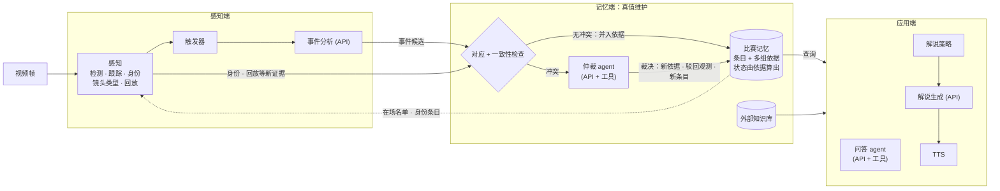
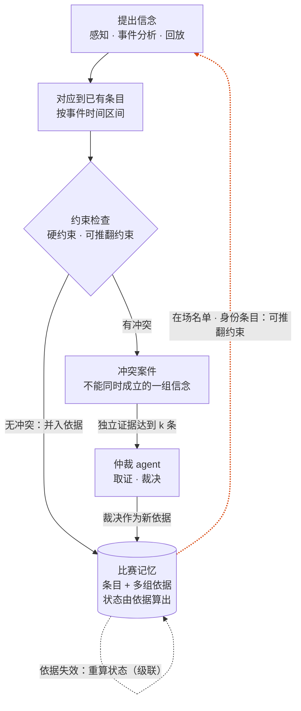

# MatchLive 设计文档

> 状态：**已审定**。
> 名称沿用论文初稿的 MatchLive，作为工作名。
> 参考实现：`~/live-comment-v2`（下文简称 v2）。
>
> **本文档的职责**：说明**做什么、为什么这样做**，包括论文主张、架构、数据契约、模块职责、闭环机制和阶段计划。修改本文档就等于修改设计决策，需要用户审定。
> **不写在这里的内容**：怎么在仓库里干活，比如环境、命令、目录用途、编码风格、git 规则。这些写在 `CLAUDE.md`。

---

## 1. 目标与论文主张

**系统目标**：足球比赛直播流 → 实时解说（字幕 + 语音）和实时问答。系统分三层：
- 感知端：球员检测、跟踪、身份识别，事件检测
- 记忆端：本场比赛的实时状态，外部知识库
- 应用端：解说、问答

**论文主张（方法层面）**：

> 把流式视频理解做成一个**神经-符号的真值维护过程**：
> - 感知模型和大模型负责**提出信念**（谁是谁、发生了什么）；
> - 比赛记忆保存每条信念，以及它的**依据**和**状态**（已确认 / 待定 / 已撤销）；
> - 规则、记忆和跨来源一致性负责**检测矛盾**；
> - 大模型**只在出现矛盾时**充当调查员，调用工具取证后裁决。裁决既可能修正记忆，也可能修正感知；
> - 修正沿依据链**级联传播**。
>
> 解说和问答读取的是带依据、带状态的记忆，所以能说出"为什么"，也能区分"确定"和"待定"。

§7 列出的各个机制都是同一个循环在不同阶段的表现：**提出 → 对应并检查 → 冲突时调查和裁决 → 依据变化时重算状态**。

**和已有工作的区别**（依据 2026-09-27 的文献检索，未必穷尽）

| 工作 | 流式 | 显式状态 | 已写入的状态可撤回 | 依据 + 级联 | 冲突触发主动取证 | 裁决可修正感知 | 规则作为冲突来源 |
|---|---|---|---|---|---|---|---|
| GameSight（arXiv 2604.00057） | ✅ | ✅ 比分 · 时序阵容 · 事件 | ❌ 只正向更新 | ❌ | ❌ | ❌ | ❌ |
| StreamSoccer（arXiv 2608.19723） | ✅ | ❌ 隐式 event token | ❌ 显式设为不可变 | ❌ | ❌ | ❌ | ❌ |
| SoccerAgent / TreeSoc | ❌ 按问题 | ❌ | — | ❌ | ❌ | ❌ | ❌ |
| MemTX / Kumiho（文本 agent 记忆） | — | ✅ | ✅ | ✅ | ❌ 按置信度 / 来源权威裁决 | 无感知 | ❌ |
| Zep / Mem0 | — | ✅ | ✅ 标记失效 | 部分 / ❌ | ❌ | 无感知 | ❌ |
| 视频 agent（VideoAgent、SVAgent、REVEAL…） | ❌ 按问题 | 无持久状态 | — | ❌ | 只针对当前问题 | ❌ | ❌ |
| 流式 VideoLLM（StreamForest、StreamChat…） | ✅ | 隐式 | ❌ 只追加 / 压缩 | ❌ | ❌ | ❌ | ❌ |
| v2 / 论文初稿 | ✅ | ✅ | ❌ | ❌ | ❌ | ❌ | 部分 |
| **本设计** | ✅ | ✅ | ✅ | ✅ | ✅ | ✅ | ✅ |

**我们的贡献**（只有这三点，按重要性排序）：
1. **流式场景下，由证据到达触发的非单调修订**：后到的证据（尤其是转播回放）和已写入的条目矛盾时，撤回或修正它，并沿依据链级联。检索到的流式视频方法都只追加或压缩，StreamSoccer 甚至显式设为不可变。
2. **感知和记忆的双向修订**：由冲突触发的 agent 会主动取证（取帧、重跑号码识别、看回放），裁决既能修正记忆，也能**修正感知结果**，还能**推断出没被观测到的事件**（从反复读到替补的号码，推出一次漏看的换人）。MemTX 等文本 agent 记忆没有感知；视频 agent 的验证只针对当前问题，结论不写回持久状态。
3. **统一的冲突表示**：违反领域规则、跨来源分歧、新证据和记忆的矛盾，都表示成"不能同时成立的一组信念"，用同一个仲裁机制处理。

**借用的机制**（论文里明确引用，不作为贡献）：
- 依据和级联撤回：JTMS（Doyle 1979）、ATMS（de Kleer 1986）。文本 agent 记忆里最接近的是 MemTX（arXiv 2607.23929）和 Kumiho（arXiv 2603.17244）。
- 双时间戳：Zep/Graphiti 的 bi-temporal 模型，以及数据库里的 valid time / transaction time。
- 显式的比分和阵容状态：GameSight。
- 其他：名单先验（Vats 等人的冰球工作）、一人一轨互斥（Lu 等，TPAMI 2013）、事件驱动调用（Dispider、StreamMind）、工具化问答（SoccerAgent）、ID 标注注入（Set-of-Mark）、计算量有界和多粒度记忆（StreamSoccer）。

**动机引用**："让大模型自己反思、自己纠错"是行不通的：没有外部反馈时，大模型的自我纠错无效（Huang 等，arXiv 2310.01798）；大模型也不擅长根据新证据修订原有结论（Belief-R，arXiv 2406.19764；STALE，arXiv 2605.06527）。所以需要显式的结构，加上来自外部的冲突信号。

**审稿人最可能用来质疑新颖性的三篇**：MemTX、GameSight、StreamSoccer。这三篇必须在相关工作里正面讨论；GameSight 和 StreamSoccer 还要作为实验对比对象。

---

## 2. 设计原则

1. **信念带依据和状态，不用概率。** 每条记忆条目都记下它的依据（哪些观测、哪些裁决），状态（**已确认 / 待定 / 已撤销**）不单独存储，由当前仍然成立的依据算出来（JTMS 的做法，见 §5.2）。系统不维护概率，**也不对大模型做离线校准**：换模型、API 悄悄升级、换球场，都不需要重新统计。分数的使用边界见 §4。
2. **约束分两类。**
   - **硬约束**：逻辑上不可能的情况，比如同一帧里一个球员对应两条轨迹、一个球员同时属于两个队。违反就直接拒绝。
   - **可推翻约束**：来自记忆的推论（在场名单、红牌之后离场）和一般足球规则。违反时**不拒绝，而是立案交给仲裁**。证据足够时，记忆本身会被修正。这就是闭环不会自我锁死的原因。
3. **冲突驱动计算。** 大模型的昂贵调用（仲裁）只花在冲突上；逐帧噪声仍然由感知端的投票机制消化，不进入仲裁。
4. **各机制都可以开关。** 开关按循环阶段组织（§7），开关之间的依赖也写在 §7。全部关掉时，系统就退化成 v2 那样的开环流水线，作为基线。消融实验只是同一份代码换一套配置。
5. **不偷看未来。** 区分*事件时间*（事情发生在比赛第几秒）和*知情时间*（系统在第几秒写入或修正了它）。在 t 时刻的查询，只能看到知情时间 ≤ t 的操作。
6. **离线运行和在线运行走同一条代码路径。** 离线时按比赛时钟回放录像，API 结果在"发起时刻 + 实测延迟"之后才生效，所以离线评测能如实反映实时部署。
7. **模块同步、可以单独测试；并发只放在最外层**（沿用 v2）。
8. **昂贵的结果全部缓存，并且记录版本。** 感知缓存分两层：原始层（检测框、轨迹、每条轨迹每帧的号码概率）只按"视频 + 模型版本"缓存，所有配置和消融共用；依赖配置的部分（身份投票等）每次现算，代价很低。API 调用按"模型名 + 版本 + 输入内容的哈希"缓存。
9. **先用 API，必要时再训练。** 大模型全部走 API（统一的 OpenAI 兼容接口）。

---

## 3. 总体架构

**图 1 数据流**：感知端提出信念，经过一致性检查写入记忆；有冲突时交给仲裁；应用端只读记忆。



**图 2 真值维护循环**：§7 的各个机制都是这个循环在不同场景下的表现。



各部分的职责：
- **感知**：逐帧运行，负责"谁在哪里"，以及"这是什么镜头、是不是回放"。
- **触发器**：决定哪些片段值得让事件分析去看，负责"提出"事件信念。
- **事件分析**：对片段提出 0 到多个事件候选。
- **一致性检查**：纯规则、不调用大模型。先把候选对应到已有条目，再检查约束；无冲突就并入依据，有冲突就立案。
- **仲裁 agent**：只处理冲突案件，带着工具去取证，写出引用证据的裁决。
- **比赛记忆**：保存条目和它们的多组依据，状态由依据算出；依据失效时沿依赖重算。
- **应用层**：只读记忆。

---

## 4. 时间与数据约定

- **比赛时间**：内部统一用 `(half, second)`，其中 `second` 是这一半场视频的秒数（SoccerNet 的视频从开球开始计时）。
  - benchmark 里的 `timestamp` 是"整场视频时间轴"上的秒数（见 `dataset/streamingqa/part1/docs.md` §4）。`timestamp = offset[match][half] + second`，下半场的偏移量**每场比赛不同**（数值见 docs.md §4，例如 Chelsea–Liverpool 是 2773；已用全部题目核对过）。
  - 所以 `(half, second)` 是唯一的主键；全局时间只在和 benchmark 对齐时，通过每场比赛的偏移表换算。已实测核对（2026-09-27）：4 个半场都没有剪辑，视频秒数和比分牌时钟一比一走，偏差在 ±1.2 秒以内（下半场视频比开球早 0.3–1.1 秒），直接把视频秒数当作比赛时钟，不做校正。MU 上半场的视频截止在 45:00，不含补时。
- **帧**：用 `(half, frame_idx)` 标识。帧率从视频读取；本地 4 个半场实测都是 25fps（每个半场含补时 45.0–50.3 分钟）。
- **框**：统一用 `ltwh`（左、上、宽、高），和 v2 一致；只在模块边界处做格式转换。
- **轨迹 ID**：用 `(shot_id, role, track_id)` 作为 key。镜头切换时跟踪器会 reset，轨迹 ID 会被重新发放，所以必须带上镜头编号；每个角色各有一个跟踪器，每个实例各自从 0 发放 ID（`trackers` 2.6），同一个 `track_id` 会同时出现在不同角色和不同镜头里。
- **球员 ID**：用 metadata 里的 `hash` 字段，它全场唯一，也能关联外部知识库。号码只是一个属性，不作为 ID。
- **分数和状态**：我们自己的模型（检测、号码识别）输出的分数，只在感知端内部使用（比如投票、判断"号码是否清楚"）。进入记忆的只有定性状态，**大模型自己报的置信度一律不用**。

---

## 5. 核心数据结构

### 5.1 感知层（逐帧产生，不进入操作日志）
```python
Detection(role, bbox_ltwh, score, class_id)                  # 沿用 v2
Track(shot_id, role, bbox_ltwh, score, track_id,
      team, player_id, identity_source)                      # role ∈ {player, goalkeeper}；identity_source: vote | entry（记忆里已确认的身份条目）
FramePerception(half, frame_idx, tracks, ball, shot)         # 一帧的全部感知结果；ball: Detection | None（场上只有一个球，不跟踪）
Shot(shot_id, start, end, kind, is_replay)                   # kind ∈ {wide, medium, closeup, other}
```
逐帧的身份投票保存在 `IdentityResolver` 里，属于感知模块自己的状态，不进入操作日志（更新太频繁）。只有**被事件引用到的轨迹**，才把它的身份写成记忆里的身份条目（§5.2）；记忆里已确认的身份条目，感知端必须遵守。

### 5.2 记忆条目（信念）
记忆里只有两种条目，内容写入后不再改变，变化都体现为依据的增加或失效：
```python
Event(entry_id, type, team, t_interval, participants, justifications)
#   t_interval:   事件时间区间（比赛时间）。直播候选取它所在的片段；回放候选取 [回放开始前 W 秒, 回放开始]
#   participants: [Participant(role, track_key | player_id)]
#                 通常引用轨迹；这条轨迹是谁由身份条目决定，所以身份一改，参与者和统计自动跟着变
Identity(entry_id, track_key, player_id, justifications)
#   "这条轨迹是这个人"。事件引用到某条轨迹时写入（依据是感知投票），仲裁也可以写入（依据是裁决）
Justification(kind, antecedents, sufficient)
#   kind:        observation（某次感知或事件分析的输出） | verdict（某个案件的裁决）
#   antecedents: 这组依据成立所需的前提（观测 ID、其他条目 ID），全部成立这组依据才成立（"与"）
#   sufficient:  这组依据单独是否足以确认（判定见 §6.4）
# 一个条目的多组依据之间是"或"
```
一组依据**成立**，是指它的前提都没有被推翻：引用的条目没有被撤销，引用的观测没有被裁决驳回。状态不存储，由依据算出（JTMS 的标注方式）：

| 状态 | 条件 |
|---|---|
| 已确认 | 至少有一组成立且充分的依据，并且不是任何未结案件的成员 |
| 待定 | 只有成立但不充分的依据，或者是某个未结案件的成员 |
| 已撤销 | 没有任何一组依据成立 |

**规则推论不存成条目**：比分（进球记给进球队，**乌龙球**记给对方）、在场和替补名单、两黄变一红和随后离场、各项统计，都由已确认的条目在推算视图时现算。当前时刻的视图在内存里增量维护，见 §6.7。

事件类型沿用 v2 的 10 类：射门、进球、黄牌、红牌、犯规、换人、点球、任意球、越位、角球。以后可以扩展。

### 5.3 冲突案件
```python
Case(case_id, members, constraint, evidence, status, verdict)
# members:    不能同时成立的一组信念（条目、观测），ATMS 里叫 nogood
# constraint: 被违反的约束（§6.4 的约束 ID）
# evidence:   并入这个案件的独立证据（同样成员、同样约束的新矛盾都并进来）
# status:     open | closed
# verdict:    裁决（可以是驳回），以及它引用的证据
```
冲突的"类型"（违反规则、来源不一致、和记忆矛盾）只是由成员推出的统计标签，不单独存储。

### 5.4 操作日志（记忆的唯一写入方式）
```python
Op(op_id, t_known, kind, payload)
# kind: add_entry | add_justification | reject_observation     （作用于条目；状态不写，由依据算出）
#       open_case | add_evidence | close_case                  （作用于案件，用于审计仲裁过程）
# t_known: 知情时间（这条操作生效时的比赛时间）
```
日志是 JSONL 格式，只追加，每条写完立即 flush，崩溃后可以通过回放日志恢复（沿用 v2）。

### 5.5 查询接口
```python
mem.at(event_time, known_by=None)    # known_by 默认等于 event_time
  .score / .on_field[side] / .bench[side] / .cards / .team_stats / .player_stats
  .events(type=, team=, player=, since=, until=, status=)
  .why(entry_id)                     # 依据链：这条信念是怎么来的
  .history(entry_id)                 # 这条信念的依据如何增加和失效，状态如何随之变化
  .dependents(entry_id)              # 哪些依据以它为前提（级联用）
```

---

## 6. 模块设计

### 6.1 感知（从 v2 移植，并做以下修改）
| 子模块 | 来源 | 修改点 |
|---|---|---|
| `detection` | v2 | 模型用 RF-DETR-L；ONNX 优先用 TensorRT EP（FP16，引擎缓存在 `cache/trt/`），不可用时依次退回 CUDA、CPU |
| `tracking` | v2 | 换用 BoT-SORT（带镜头运动补偿，两个角色共用一次光流估计；SoccerNet-GSR 上 HOTA 65.3，ByteTrack 63.6）；镜头切换时显式调用 reset。**只跟踪球员和门将**：球每帧取得分最高、超过阈值的检测框，不跟踪（GSR 上跟踪不优于逐帧取最高分，BoT-SORT 会把球的召回率降到 0.30） |
| `jersey` | v2 | 检查点用 `jersey_dinov3_convnext_tiny-20_matches`，导出 ONNX，TensorRT FP16 推理（和检测相同）；`predict_batch` 返回**完整的 101 维概率**，用于判断"号码是否清楚"以及做候选约束；修复 v2 在 transformers 5.x 下检查点加载失败的问题（细节见 CLAUDE.md 的移植注意事项） |
| `identity` | v2 | (a) 在场名单作为**可推翻约束**：只在场上球员里投票；读到名单以外的号码时**不丢弃**，而是作为证据交给一致性检查；(b) 同一帧内一个球员最多对应一条轨迹（匈牙利算法，硬约束）；(c) 遵守记忆里已确认的身份条目；(d) 修复 v2 把门将球衣颜色当成第 3、4 支队伍的问题（见 CLAUDE.md 的移植注意事项）；(e) 队伍颜色改用去掉草地和皮肤后的平均 LAB 颜色（v2 的主色 k-means 会丢掉白色、黑色球衣），外场球员的颜色按两簇在线聚类判定队伍，metadata 球衣颜色太粗，只用来给两簇命名主队或客队 |
| `shots`（新） | — | 镜头切换检测（相邻帧颜色直方图差）；镜头类型用感知统计判断（草地占比、框的数量和大小）；**回放检测用台标转场（logo wipe）**，这是转播里最可靠的信号；召回不够时再考虑加 API 兜底 |
| `calibration`（可选，阶段 6 以后） | NBJW（MIT 许可） | 只在远景镜头上跑，而且要判断结果是否可信；每隔几帧跑一次，中间插值 |
| `visualization` | v2 | 新增一种"只画 ID 标签"的轻量模式，供事件分析使用 |

**跨镜头身份延续**（审稿人指出的真实瓶颈）：远景里号码大多看不清，身份主要在特写镜头里建立，而且每次切镜头都会断。第一版的做法：
- 在同一个镜头内投票；
- 跨镜头时，只在"短暂插入特写后切回远景"这种情况下，按位置和队伍把轨迹接上；
- 外观 re-ID 留到阶段 3 评估。

### 6.2 触发器
负责决定哪些片段交给事件分析，也就是"提出"事件信念。输入是逐帧感知结果和镜头信息，输出是 `Segment(t0, t1, reasons)`。第一版的信号：
- **导演切镜头**：从远景切到特写或回放，通常意味着刚刚发生了什么。
- **比赛停顿**：远景里球员整体运动量持续很低。只把"检测不到球"作为辅助信号，因为高球和遮挡时也会检测不到。
- **球员聚集**。
- **保底心跳**：H 秒（比如 30 秒）内没有任何片段被分析过时，补分析一次，只覆盖还没分析过的时间段。

片段范围是触发时刻往前 `pre` 秒、往后 `post` 秒，重叠的片段会合并。回放镜头不作为直播片段送去分析，只走 §6.5。开关见 §7。

### 6.3 事件分析（API）
**输入**：
1. 片段内按 2fps 抽取的帧，画面上只标 ID 标签（比如 `P3`）。
2. 结构化的感知文本：每个 ID 对应的身份（`P3 = Chelsea #10 Hazard，号码在第 4–9 帧清楚可见`），离球最近的是谁、在哪些帧，以及镜头序列。
3. 静态信息：队名、球衣颜色、进攻方向。

**不给记忆摘要**：提出方只看画面和感知结果，和记忆的比对只在一致性检查里做。这样大模型不会顺着记忆说，把本该暴露的矛盾抹掉；输入也不随记忆变化，不同消融之间的 API 缓存可以共用。

**输出**：0 到多个事件候选，每个包含类型、在片段内的大致帧号、队伍、参与者（用 P-ID 指代）和证据帧。**不要求大模型给出置信度。**

**和 v2 的关键区别**：
- 参与者用 **P-ID 指代**，直接映射到轨迹和球员，大模型不用再从图上把号码读一遍。
- 可以返回多个事件。
- 和解说**解耦**：解说由应用层单独负责。

身份信息的注入方式作为消融项，只做两档：`overlay_full`（v2 的做法）和 `ids_text`（本设计）。开关见 §7。

### 6.4 一致性检查（纯规则，不调用大模型）
每个新提出的信念（事件候选、名单以外的号码读数、回放里的观测）分两步处理。

**第 1 步：对应到已有条目。** 在记忆里找事件时间区间有重叠、类型相同的条目（回放候选的区间见 §5.2，所以回放不需要单独的对应规则）：
- 恰好一个：候选成为这个条目的一组新依据；如果参与者的说法不同，就产生冲突。
- 没有：新增条目。
- 多个（比如连续两个角球、延迟回放）：立案，交给仲裁判断对应哪一个。

号码读数同理，对应到这条轨迹的身份条目。

**第 2 步：约束检查。** 规则只有两种：
- **推论**：比分、在场名单、两黄变一红和随后离场，都在推算视图时现算（§5.2），不是检查项。
- **约束**：一组不能同时成立的信念。违反硬约束，直接拒绝新信念；违反可推翻约束，就立案（§5.3）。

约束表（依据 IFAB 规则；具体数值按赛事配置）：

| 约束 | 类型 |
|---|---|
| 同一帧一个球员只对应一条轨迹；一个球员只属于一个队 | 硬约束 |
| 已被罚下或已被换下的球员，之后不能再在场上出现 | 可推翻 |
| 换人：被换下的人在场上，被换上的人在替补席，两人同队，次数不超过赛事上限（2016 年英超是 3 次，现代多数赛事是 5 次） | 可推翻 |
| 同一个对象的两个说法必须一致（同一事件的参与者、同一条轨迹的身份） | 可推翻 |

注意：吃牌的人可以是场上球员、替补或已被换下的球员，所以"被罚牌者必须在场上"不是约束。

**依据是否充分**：各来源说法一致，而且参与者对应的身份条目已确认（号码在证据帧里清楚可读），这组依据就是充分的；只有单一来源，或者号码没看清，就不充分。

**上报仲裁**：同一个案件并入的独立证据达到 k 条，就交给仲裁。事件层面的冲突 k=1；来自逐帧感知的冲突（比如反复读到替补的号码）k 取较大的值，避免一次误读就惊动仲裁。案件只有在新证据并入时才会再次上报。

开关见 §7。

### 6.5 回放
回放只是一种**事件时间不确定的证据来源**，没有单独的规则：
1. 识别回放：见 §6.1（台标转场）。
2. 对回放片段做事件分析；候选的事件时间区间取 [回放开始前 W 秒, 回放开始]（W 比如 90 秒）。
3. 之后完全按 §6.4 处理：对应到唯一条目，就成为它的一组新依据（可能让待定变成已确认，也可能产生冲突）；对应不到，就新增为待定条目（直播时漏掉的事件）；对应到多个，就立案。

开关见 §7。

### 6.6 仲裁 agent（API + 工具）
**输入**：一个案件，包括成员、被违反的约束、并入的证据，以及成员的依据链（`why()`）。依据里引用过的分析输出（按调用 ID）直接附上，不重发原图；只有需要新证据时才取帧。

**工具**（都受当前知情时间约束，不能看未来）：§6.9 的共享只读工具，外加仲裁专用的取证工具：
- `get_frames(t0, t1)`：取原始帧
- `get_track_crops(track_key)`：取一条轨迹的截图
- `rerun_jersey(track_key)`：查看指定帧上的号码识别结果（优先读原始感知缓存里的概率，必要时才重跑）
- `find_replays(t0, t1)`：找出这段时间之后的回放镜头

**先便宜后昂贵**：先只对相关片段重跑事件分析、或者查看号码识别结果；不够再启动完整的多轮 agent。

**输出**：裁决是一组写入：给某个条目加一组 verdict 依据；驳回某些观测（比如判定一次号码读数是误读）；新增条目（比如推断出的漏看换人，或者一条轨迹的正确身份）。**每一条都必须引用工具返回的证据**。条目的状态随之由依据重新算出。

**护栏**：
- 裁决不能违反硬约束，违反的裁决直接作废。
- 案件有调用预算和截止时间。超时的案件保持未结，成员保持待定，不阻塞任何流程。
- 裁决本身也写进操作日志，所以可以审计；它只是一组依据，以后也可以被新的裁决推翻。

开关见 §7。

### 6.7 比赛记忆（真值维护）
在 v2 `core/memory.py` 的基础上扩展：
- 从"事件日志"改成"操作日志"，增加知情时间。
- 条目内容写入后不变；变化都体现为依据的增加或失效（§5.2、§5.4）。
- 状态由依据算出；规则推论在推算视图时现算（§5.2）。
- **级联**：某个条目被撤销、或者某个观测被驳回时，沿 `dependents()` 找出以它为前提的依据，重算这些条目的状态，直到不再变化。因为推论不存储：
  - 撤销一张黄牌后，两黄推出的红牌和离场自然消失；直接观测到的红牌是独立条目，不受影响；
  - 一条身份条目被撤销后，引用这条轨迹的事件，参与者自动改成新的身份。
- **读取**：维护一个随每条操作增量更新的"当前视图"，供感知、一致性检查、解说高频读取；只有查询过去时刻（问答、仲裁）时才重放日志。
- 查询接口见 §5.5。

纯逻辑，除了读写日志文件之外不依赖任何外部资源，可以脱离视频和 API 做完整的单元测试。

### 6.8 外部知识库
- 离线构建，每场比赛一份。来源是 metadata（位置、国籍、阵型、场地、裁判）和可选的 Wikipedia 摘要，用球员 hash 作为 key。
- **防止信息泄漏**：
  - Wikipedia 上的内容包含比赛之后才发生的事，只能使用比赛日期之前的事实。第一版只用 metadata，加上人工确认过的简介。
  - metadata 里凡是赛后信息（比分字段、换人时间等）都**不能**进入知识库或在场名单。在场名单只能由首发名单加上系统自己检测到的换人推出。

### 6.9 应用层
- **共享只读工具**（问答和仲裁共用，都受提问时刻或知情时间约束）：
  - `get_state()`、`list_events(filter)`、`get_player(name | team+jersey)`、`why(entry_id)`
  - `get_event_evidence(entry_id)`：返回证据帧
  - `kb_lookup(player)`
- **问答 agent**：用 API 的 function calling 调用共享工具，另加 `get_current_view()`（最近几帧加上感知摘要，用来回答"现在谁在罚角球"这类问题）。开关见 §7。
- **解说策略**：每隔一个固定间隔，或者记忆发生变化时，决定这一次做什么：沉默、讲当前事件、播报修正、状态回顾、背景知识。**措辞跟着条目状态走**：
  - 已确认的直接点名；
  - 待定的只说队名，或者说"看起来是……"；
  - 一个已经播出的判断被修正时，播报修正："刚才的回放显示，射门的其实是……"。
- **解说生成（API）**：根据策略给出的素材生成一句话。
- **TTS**：从 v2 的 MiniMax 实现移植过来。

### 6.10 运行时
- **`MatchRunner`**：按比赛时钟逐帧驱动各模块。
  - 离线模式：不等待真实时间；API 结果（包括仲裁裁决）在"发起时刻 + 延迟"之后生效。延迟可以取实测值，也可以取固定值。
  - 在线模式：同一套逻辑，改用真实时钟。
- **所有 API 调用都是异步的**（事件分析、仲裁、解说生成）：发起后返回 future，结果在"发起时刻 + 延迟"生效；感知循环永远不等待 API。
- **Orchestrator 和延迟混流**（v2 的恒定节奏、"丢帧不阻塞"设计）：放到阶段 7，只服务于 demo 和延迟测量。

---

## 7. 机制和开关（按循环阶段组织，也就是消融实验的开关）

| 阶段 | 开关 | 打开时 | 关掉之后（基线） |
|---|---|---|---|
| 提出 | `loop.trigger` | 触发器按感知信号挑选直播片段 | 固定 10 秒窗口（v2） |
| 提出 | `loop.replay` | 回放作为事件时间不确定的证据，走对应和检查 | 回放当作普通直播片段分析（v2） |
| 提出 | `loop.state_to_perception` | 在场名单和已确认的身份条目作为可推翻约束交给感知；名单以外的号码读数作为证据进入检查 | 用全场完整名单硬过滤（v2） |
| 提出 | `perception.inject` | `ids_text` | `overlay_full`（v2） |
| 检查 | `loop.consistency` | 对应 + 约束检查，状态由依据算出 | 候选直接写成已确认（v2） |
| 裁决 | `loop.arbiter` | 冲突交给 agent 取证裁决 | 冲突时直接拒绝新信念 |
| 传播 | `loop.cascade` | 依据失效时沿依赖重算状态 | 只重算被直接改动的条目 |
| 应用 | `qa.mode` | `tools`：按状态读取，能回答"为什么" | `dump_log`：整份日志塞给大模型（v2） |

应用层是循环的使用者，不在循环里。**全部关掉时，就是 v2 的基线。**

开关之间的依赖：`loop.arbiter`、`loop.cascade`、`loop.replay`，以及 `loop.state_to_perception` 里"名单以外的读数作为证据"这一部分，都要求 `loop.consistency` 打开，否则不会产生案件和待定条目。

---

## 8. 包结构（模块划分）

Python 包 `matchlive/` 下的子包和 §6 的模块一一对应。仓库其余目录的用途见 `CLAUDE.md`。
```
matchlive/
├── common/        # 类型、时间换算(§4)、配置、缓存、API 客户端
├── perception/    # §6.1  detection tracking jersey identity shots calibration visualization
├── events/        # §6.2–6.5  trigger analyzer consistency replay
├── memory/        # §6.7–6.8  store(操作日志 + 依据 + 推算) kb
├── arbiter/       # §6.6  仲裁 agent 和它的工具
├── app/           # §6.9  qa commentary tts
└── runtime/       # §6.10 runner(离线/在线) orchestrator
```
依赖规则：
- `perception`、`memory` 只依赖 `common`。
- `events`、`arbiter`、`app` 可以使用它们的数据类型，但不持有它们的实例。
- 只有 `runtime` 把各模块连起来。

闭环里的反馈（把在场名单和身份条目交给感知、把记忆快照交给一致性检查、把案件交给仲裁）一律由 `runtime` 显式传参完成，模块之间不互相调用（这一点沿用 v2：`commentary/events.py` 不 import `core.memory`）。仲裁的工具由 `runtime` 注入。

---

## 9. 运行资源约束
- 本机 GPU 是 RTX 4060 Ti 8GB：够跑检测（RF-DETR-L，TensorRT FP16）和号码识别的推理，但跑不了本地 VLM。这也是"先用 API"的现实前提。
- 需要微调或本地部署 VLM 时，要另找服务器，届时再修订本节。

---

## 10. 实施计划与验收标准

| 阶段 | 内容 | 验收标准 |
|---|---|---|
| 0 底座 | 仓库结构、配置、环境；移植感知模块（含 §6.1 的修改）；`MatchRunner` 离线模式；感知缓存 | 本机跑完一场比赛的一个半场，感知缓存写到磁盘；抽 60 帧的叠加视频人工检查，结果和 v2 一致或更好；报告每帧耗时，以及能否达到实时（25fps）；在 SoccerNet-GSR 上报告身份指标（队伍准确率，号码覆盖率和准确率），和 v2 式投票对比。达不到时：检测隔帧运行、中间由跟踪补齐；号码识别只跑在身份未定、框足够大的轨迹上 |
| 1 记忆 | 操作日志、依据、状态推算、知情时间、级联、查询 | 单元测试覆盖：新增条目、增加依据、驳回观测、状态推算、按时刻查询、崩溃恢复；**级联**：撤销一张黄牌后，两黄推出的红牌和离场消失，而直接观测到的红牌不受影响；撤销一条身份条目后，引用这条轨迹的事件的参与者和统计随之改变 |
| 2 事件 | 镜头和回放检测、触发器、事件分析（API + 缓存）、对应和一致性检查 | 在真值事件上报告召回率、精确率、每场调用次数，和固定窗口基线对比；报告每条规则的触发次数和误报 |
| 3 仲裁 | 仲裁 agent、工具、护栏、案件上报 | 每场的案件数、裁决正确率、每个案件的调用次数和延迟 |
| 4 记忆 → 感知 + 回放 | `loop.state_to_perception`、`loop.replay` | 身份准确率和覆盖率，开环和闭环对比；**错误注入实验**：人为删掉一次换人、把一张黄牌记给错的人，看系统能否、以及多久能自我纠正 |
| 5 应用 | 问答 agent、知识库、解说策略和生成 | benchmark 题目能端到端跑通；报告 `dump_log` 和 `tools` 两种模式的结果 |
| 6 标定（可选） | NBJW | 抽帧把球场线叠回画面人工检查，并测速度 |
| 7 实时 / demo | orchestrator、TTS、混流 | 各环节延迟，以及延迟和覆盖率的权衡曲线 |

**评测需要新增的指标**（审稿人要求，针对"修正"本身）：
- 正确率随知情时间变化的曲线：同一个事件，在发生后 5 秒、30 秒、2 分钟时分别有多准。
- 修正延迟：一个错误从写入到被纠正要多久。
- 错误修正率：把对的改成错的比例。
- 更换 API 模型后，各个机制带来的提升是否依然成立（检验"不做离线校准"的主张）。
- **"后到证据推翻早先条目"的专项统计**：这类案例有多少、撤回是否正确、级联是否正确。只追加或不可变的方法（GameSight、StreamSoccer）在结构上就处理不了这类案例，这是最直接的对比。
- **和置信度门控对比**：用"大模型置信度超过阈值才写入"替换定性状态（类似 MemTX 的做法），证明不用概率不是缺点。
- **对照基线**：GameSight 式的只正向更新状态、StreamSoccer 式的不可变事件记忆，都在同一套感知结果上实现。

---

## 11. 待决问题与风险

**待确认**
1. **真值事件标注在哪里**：本地只有视频和 `metadata.json`，没有 SoccerNet 的 `Labels-v2.json` 或 caption 标注。阶段 2 需要它们来评测事件检测。
2. **SoccerNet-v2 的镜头和回放标注**能否获取？有的话，回放检测可以直接评测。
3. **用哪个 API 模型**（Gemini / Qwen / Kimi / Claude……）以及预算：先在阶段 2 用一个半场估算每场的调用量和费用。
4. **公开基准**：是否在 SoccerNet 2026 Player-Centric Ball Action Spotting（事件要带执行者的队伍和号码）上报告结果。

**已决定**（2026-09-27）
- **D1 只用画面，不用转播图形和解说音频**：不专门去读比分牌和字幕（不做 OCR 模块），也不用解说的语音识别。论文里要说明这样设定的理由，并正面回应审稿人"用 OCR 加语音识别几乎是必胜基线"的质疑。画面本身不做特殊处理：比分牌在帧里照常可见，不遮挡；台标转场照常用于回放检测（§6.1）。
- **D2 不做第二个运动领域**：方法的可迁移性，只在论文里通过抽象层次的论述来说明（规则集和状态结构可以替换）。
- **D3 事件分析和解说生成保持两次独立的 API 调用**（§6.3、§6.9）：解说要依赖一致性检查之后的条目状态和记忆变化，由此多出一次串行调用的延迟，由输出的固定延迟窗口吸收。

**风险**
- **仲裁本身会出错**：护栏（§6.6）只能限制它的破坏范围，不能保证它裁对。错误修正率必须单独评测。
- **相关错误**：几个来源同时被同一个模糊画面骗了，就会"一致但都错"，一致性检查查不出来。办法是尽量让不同来源看不同的证据（直播画面和回放特写），并在评测里单独统计这类错误。
- **案件上报阈值 k 需要人为设定**：通过敏感性实验证明结果对它不敏感。
- **仲裁的费用和延迟**：在比赛高峰（进球后连续回放）可能出现很多案件。靠预算和截止时间兜底，超时的案件保持未结，成员保持待定。
- 启发式触发器的召回率不确定，所以保留保底心跳，并在阶段 2 专门评测。
- 目前只有 2 场比赛，而且都是切尔西主场，规则和阈值很容易调得过拟合这两场。需要尽早扩充比赛数量，把调参用的比赛和评测用的比赛分开。
