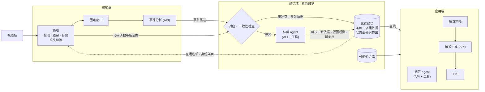
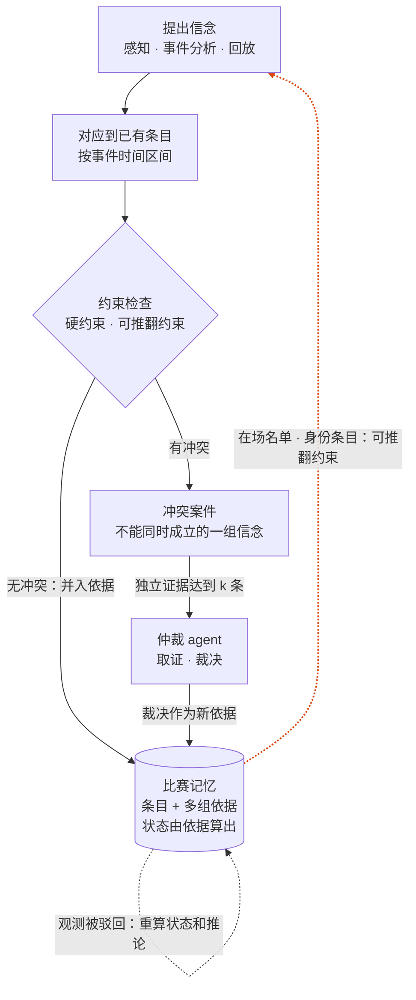

# MatchLive 设计文档

> 状态：**已审定**。
> 名称沿用论文初稿的 MatchLive，作为工作名。
> 参考实现：`~/live-comment-v2`（下文简称 v2）。
>
> **本文档的职责**：说明**做什么、为什么这样做**，包括论文主张、架构、数据契约、模块职责、闭环机制和阶段计划。修改本文档就等于修改设计决策，需要用户审定。
> **不写在这里的内容**：怎么在仓库里干活，比如环境、命令、目录用途、编码风格、git 规则。这些写在 `CLAUDE.md`；新机器的环境和数据准备写在 `SETUP.md`。

---

## 1. 目标与论文主张

**系统目标**：足球比赛直播流 → 实时解说（字幕 + 语音）和实时问答。系统分三层：
- 感知端：球员检测、跟踪、身份识别，事件检测
- 记忆端：本场比赛的实时状态，外部知识库
- 应用端：解说、问答

**论文主张（方法层面）**：

> 把流式视频理解做成一个**神经-符号的真值维护过程**：
> - 感知模型和大模型负责**提出信念**（谁是谁、发生了什么）；
> - 比赛记忆保存每条信念，以及它的**依据**和**状态**（已确认 / 待定 / 已撤销）；
> - 规则、记忆和跨来源一致性负责**检测矛盾**；
> - 大模型**只在出现矛盾时**充当调查员，调用工具取证后裁决。裁决既可能修正记忆，也可能修正感知；
> - 修正**自动传到由它推出的所有结论**：推论不存储，每次由当前的证据现算。
>
> 解说和问答读取的是带依据、带状态的记忆，所以能说出"为什么"，也能区分"确定"和"待定"。

§7 列出的各个机制都是同一个循环在不同阶段的表现：**提出 → 对应并检查 → 冲突时调查和裁决 → 依据变化时重算状态**。

**和已有工作的区别**（依据 2026-09-27 的文献检索，未必穷尽）

| 工作 | 流式 | 显式状态 | 已写入的状态可撤回 | 依据 + 级联 | 冲突触发主动取证 | 裁决可修正感知 | 规则作为冲突来源 |
|---|---|---|---|---|---|---|---|
| GameSight（arXiv 2604.00057） | ✅ | ✅ 比分 · 时序阵容 · 事件 | ❌ 只正向更新 | ❌ | ❌ | ❌ | ❌ |
| StreamSoccer（arXiv 2608.19723） | ✅ | ❌ 隐式 event token | ❌ 显式设为不可变 | ❌ | ❌ | ❌ | ❌ |
| SoccerAgent / TreeSoc | ❌ 按问题 | ❌ | — | ❌ | ❌ | ❌ | ❌ |
| MemTX / Kumiho（文本 agent 记忆） | — | ✅ | ✅ | ✅ | ❌ 按置信度 / 来源权威裁决 | 无感知 | ❌ |
| Zep / Mem0 | — | ✅ | ✅ 标记失效 | 部分 / ❌ | ❌ | 无感知 | ❌ |
| 视频 agent（VideoAgent、SVAgent、REVEAL…） | ❌ 按问题 | 无持久状态 | — | ❌ | 只针对当前问题 | ❌ | ❌ |
| 流式 VideoLLM（StreamForest、StreamChat…） | ✅ | 隐式 | ❌ 只追加 / 压缩 | ❌ | ❌ | ❌ | ❌ |
| v2 / 论文初稿 | ✅ | ✅ | ❌ | ❌ | ❌ | ❌ | 部分 |
| **本设计** | ✅ | ✅ | ✅ | ✅ | ✅ | ✅ | ✅ |

**我们的贡献**（只有这三点，按重要性排序）：
1. **流式场景下，由证据到达触发的非单调修订**：后到的证据（尤其是转播回放）和已写入的条目矛盾时，撤回或修正它，由它推出的结论随之改变。检索到的流式视频方法都只追加或压缩，StreamSoccer 甚至显式设为不可变。
2. **感知和记忆的双向修订**：由冲突触发的 agent 会主动取证（取帧、重跑号码识别、看回放），裁决既能修正记忆，也能**修正感知结果**，还能**推断出没被观测到的事件**（从反复读到替补的号码，推出一次漏看的换人）。MemTX 等文本 agent 记忆没有感知；视频 agent 的验证只针对当前问题，结论不写回持久状态。
3. **统一的冲突表示**：违反领域规则、跨来源分歧、新证据和记忆的矛盾，都表示成"不能同时成立的一组信念"，用同一个仲裁机制处理。

**借用的机制**（论文里明确引用，不作为贡献）：
- 依据和级联撤回：JTMS（Doyle 1979）、ATMS（de Kleer 1986）。文本 agent 记忆里最接近的是 MemTX（arXiv 2607.23929）和 Kumiho（arXiv 2603.17244）。
- 双时间戳：Zep/Graphiti 的 bi-temporal 模型，以及数据库里的 valid time / transaction time。
- 显式的比分和阵容状态：GameSight。
- 其他：名单先验（Vats 等人的冰球工作）、一人一轨互斥（Lu 等，TPAMI 2013）、事件驱动调用（Dispider、StreamMind）、工具化问答（SoccerAgent）、ID 标注注入（Set-of-Mark）、计算量有界和多粒度记忆（StreamSoccer）。

**动机引用**："让大模型自己反思、自己纠错"是行不通的：没有外部反馈时，大模型的自我纠错无效（Huang 等，arXiv 2310.01798）；大模型也不擅长根据新证据修订原有结论（Belief-R，arXiv 2406.19764；STALE，arXiv 2605.06527）。所以需要显式的结构，加上来自外部的冲突信号。

**审稿人最可能用来质疑新颖性的三篇**：MemTX、GameSight、StreamSoccer。这三篇必须在相关工作里正面讨论；GameSight 和 StreamSoccer 还要作为实验对比对象。

---

## 2. 设计原则

1. **信念带依据和状态，不用概率。** 每条记忆条目都记下它的依据（哪些观测、哪些裁决），状态（**已确认 / 待定 / 已撤销**）不单独存储，由当前仍然成立的依据算出来（JTMS 的做法，见 §5.2）。系统不维护概率，**也不对大模型做离线校准**：换模型、API 悄悄升级、换球场，都不需要重新统计。分数的使用边界见 §4。
2. **约束分两类。**
   - **硬约束**：逻辑上不可能的情况，比如同一帧里一个球员对应两条轨迹、一个球员同时属于两个队。违反就直接拒绝。
   - **可推翻约束**：来自记忆的推论（在场名单、红牌之后离场）和一般足球规则。违反时**不拒绝，而是立案交给仲裁**。证据足够时，记忆本身会被修正。这就是闭环不会自我锁死的原因。
3. **冲突驱动计算。** 大模型的昂贵调用（仲裁）只花在冲突上；逐帧噪声仍然由感知端的投票机制消化，不进入仲裁。
4. **各机制都可以开关。** 开关按循环阶段组织（§7），开关之间的依赖也写在 §7。全部关掉时，系统就退化成 v2 那样的开环流水线，作为基线。消融实验只是同一份代码换一套配置。
5. **不偷看未来。** 区分*事件时间*（事情发生在比赛第几秒）和*知情时间*（系统在第几秒写入或修正了它）。在 t 时刻的查询，只能看到知情时间 ≤ t 的操作。
6. **离线运行和在线运行走同一条代码路径。** 离线时按比赛时钟回放录像，API 结果在"发起时刻 + 实测延迟"之后才生效，所以离线评测能如实反映实时部署。
7. **模块同步、可以单独测试；并发只放在最外层**（沿用 v2）。
8. **昂贵的结果全部缓存，并且记录版本。** 感知缓存分两层：原始层（检测框、轨迹、每条轨迹每帧最可能的号码和它的概率）只按"视频 + 模型版本"缓存，所有配置和消融共用；依赖配置的部分（身份投票等）每次现算，代价很低。API 调用按"模型名 + 版本 + 输入内容的哈希"缓存。
9. **先用 API，必要时再训练。** 大模型全部走 API，经 OpenAI 兼容接口调用（接口地址和模型名在配置里，目前是 `gemini-3.8-flash`；2026-09-29 之前经 Google 的 `google.genai` SDK 直连 Gemini，由用户决定换成兼容接口）。

---

## 3. 总体架构

**图 1 数据流**：感知端提出信念，经过一致性检查写入记忆；有冲突时交给仲裁；应用端只读记忆。



**图 2 真值维护循环**：§7 的各个机制都是这个循环在不同场景下的表现。



各部分的职责：
- **感知**：逐帧运行，负责"谁在哪里"，以及镜头在哪里切换。
- **固定窗口**：把整场比赛切成首尾相接的窗口，逐个交给事件分析，负责"提出"事件信念。
- **事件分析**：对每个窗口提出 0 到多个事件候选。
- **一致性检查**：纯规则、不调用大模型。先把候选对应到已有条目，再检查约束；无冲突就并入依据，有冲突就立案。
- **仲裁 agent**：只处理冲突案件，带着工具去取证，写出引用证据的裁决。
- **比赛记忆**：保存条目和它们的多条依据；状态和规则推论都在读取时由依据现算，所以观测被驳回后，一切随之改变。
- **应用层**：只读记忆。

---

## 4. 时间与数据约定

- **比赛时间**：内部统一用 `(half, second)`，其中 `second` 是这一半场视频的秒数（SoccerNet 的视频从开球开始计时）。
  - benchmark 里的 `timestamp` 是"整场视频时间轴"上的秒数（见 `dataset/streamingqa/part1/docs.md` §4）。`timestamp = offset[match][half] + second`，下半场的偏移量**每场比赛不同**（数值见 docs.md §4，例如 Chelsea–Liverpool 是 2773；已用全部题目核对过）。
  - 所以 `(half, second)` 是唯一的主键；全局时间只在和 benchmark 对齐时，通过每场比赛的偏移表换算。已实测核对（2026-09-27）：4 个半场都没有剪辑，视频秒数和比分牌时钟一比一走，偏差在 ±1.2 秒以内（下半场视频比开球早 0.3–1.1 秒），直接把视频秒数当作比赛时钟，不做校正。MU 上半场的视频截止在 45:00，不含补时。
- **帧**：用 `(half, frame_idx)` 标识。帧率从视频读取；本地 4 个半场实测都是 25fps（每个半场含补时 45.0–50.3 分钟）。
- **框**：统一用 `ltwh`（左、上、宽、高），和 v2 一致；只在模块边界处做格式转换。
- **轨迹 ID**：用 `(half, shot_id, track_id)` 作为 key。镜头切换时跟踪器会 reset，轨迹 ID 会被重新发放，所以必须带上镜头编号；镜头编号每个半场从 0 开始，所以还要带上半场。感知模块一次只处理一个半场，内部用 `(shot_id, track_id)`；轨迹离开感知端（写入记忆、交给事件分析和仲裁）时一律带上 `half`。角色（球员 / 门将）是轨迹的属性，不放进 key：它由这条轨迹匹配到的检测类别多数投票得出，可能在轨迹中途改变。
- **球员 ID**：用 metadata 里的 `hash` 字段，它全场唯一，也能关联外部知识库。号码只是一个属性，不作为 ID。
- **分数和状态**：我们自己的模型（检测、号码识别）输出的分数，只在感知端内部使用（比如投票、判断"号码是否清楚"）。进入记忆的只有定性状态，**大模型自己报的置信度一律不用**。

---

## 5. 核心数据结构

### 5.1 感知层（逐帧产生，不进入操作日志）
```python
Detection(role, bbox_ltwh, score, class_id)                  # 沿用 v2
Track(shot_id, role, bbox_ltwh, score, track_id,
      team, player_id, identity_source)                      # role ∈ {player, goalkeeper}，按检测类别多数投票；identity_source: vote | entry（记忆里已确认的身份条目）
FramePerception(half, frame_idx, tracks, ball, shot)         # 一帧的全部感知结果；ball: Detection | None（场上只有一个球，不跟踪）
Shot(shot_id, start, end)                                    # 只有切换点；镜头类型和回放检测已搁置（§6.1）
```
逐帧的身份投票保存在 `IdentityResolver` 里，属于感知模块自己的状态，不进入操作日志（更新太频繁）。窗口结束时用这些票对窗口内的帧解析一次（§6.1 (f)）。只有**被事件引用到的轨迹**，才把它的身份写成记忆里的身份条目（§5.2）；记忆里已确认的身份条目，感知端必须遵守。

### 5.2 记忆条目（信念）
记忆里只有两种条目，内容写入后不再改变，变化都体现为依据的增加或失效：
```python
Event(entry_id, type, team, t_interval, participants, justifications)
#   t_interval:   事件时间区间（比赛时间）。直播候选取事件分析给出的时刻前后 δ 秒（δ 按类型设，比如 10 秒，换人 45 秒，因为举牌到换人要几十秒；取整个窗口的话，同一窗口里的两次射门会被当成一个）；回放候选取 [窗口开始前 W 秒, 窗口结束]（§6.5）
#   participants: [Participant(role, track_key | player_id)]
#                 通常引用轨迹；这条轨迹是谁由身份条目决定，所以身份一改，参与者和统计自动跟着变
Identity(entry_id, track_key, player_id, justifications)
#   "这条轨迹是这个人"。事件引用到某条轨迹时写入（依据是感知投票），仲裁也可以写入（依据是裁决）
Justification(obs_id, kind, sufficient, of)
#   obs_id:     支持这条信念的一次观测：事件分析的一个候选、一次号码读数、一次回放分析，
#               或者一次裁决（ID 为 verdict:<案件 ID>）。观测本身存在 API 缓存或感知缓存里，这里只引用 ID
#   kind:       observation | recheck | verdict
#               recheck：同一个事件分析对同一事件的复核（§6.4），不算独立来源
#   sufficient: 这次观测单独是否足以确认（判定见 §6.4）
#   of:         这条依据所依赖的观测，只在它仍然成立时才成立：复核（kind = recheck）依赖被复核的
#               那次观测（看的是同一段画面）；犯规和任意球配对时，对方的观测依赖条目自己的那次
#               观测（§6.4）
# 一个条目的多条依据之间是"或"；依据只引用观测，不引用其他条目
```
一条依据**成立**，是指它的观测没有被驳回（驳回一次裁决，就是驳回 `verdict:<案件 ID>`）；带 `of` 的依据还要求 `of` 那次观测没有被驳回。状态不存储，由依据算出（JTMS 的标注方式）：

| 状态 | 条件 |
|---|---|
| 已确认 | 至少有一条成立且充分的依据，并且不是任何未结案件的成员 |
| 待定 | 只有成立但不充分的依据，或者是某个未结案件的成员 |
| 已撤销 | 所有依据都被驳回 |

**规则推论不存成条目**：比分、在场和替补名单、两黄变一红和随后离场、各项统计，都在读取时由已确认的条目现算（§6.7）。修正能传到所有推论，靠的就是这一点，不需要依赖追踪。
- 比分直接按进球事件的 `team` 计：`team` 是得分的一方（乌龙球也记为得分方），由事件分析给出。
- 参与者的 `role` 只有推论用得到的几种有约定：每个事件的主要执行者是 `player`，换人是 `out` / `in`。其他角色（如被犯规的人）可以出现，但不参与推论。
- 推算时，事件按区间终点计时（"确定已发生"的时刻），用来判断到某一时刻是否已发生，以及给事件排先后顺序。

事件类型沿用 v2 的 10 类：射门、进球、黄牌、红牌、犯规、换人、点球、任意球、越位、角球，外加伤停（injury：比赛因球员受伤停下，streaming-QA benchmark 要问）。以后可以扩展。

### 5.3 冲突案件
```python
Case(case_id, members, constraint, evidence, status, verdict)
# members:    不能同时成立的一组信念（条目、观测），ATMS 里叫 nogood；互斥类案件只放新条目（§6.4）
# constraint: 被违反的约束（§6.4 的约束 ID）
# evidence:   并入这个案件的独立证据（同样成员、同样约束的新矛盾都并进来）；互斥类案件里还有
#             与新条目冲突的原有条目，作为上下文交给仲裁
# status:     open | closed
# verdict:    裁决（可以是驳回），以及它引用的证据
```
冲突的"类型"（违反规则、来源不一致、和记忆矛盾）只是由成员推出的统计标签，不单独存储。

### 5.4 操作日志（记忆的唯一写入方式）
```python
Op(op_id, t_known, kind, payload)
# kind: add_entry | add_justification | reject_observation     （作用于条目；状态不写，由依据算出）
#       open_case | add_evidence | close_case                  （作用于案件，用于审计仲裁过程）
# t_known: 知情时间（这条操作生效时的比赛时间）
```
日志是 JSONL 格式，只追加，每条写完立即 flush（沿用 v2）；`t_known` 不减，所以知情时间不晚于 t 的操作正好是日志的一个前缀。

### 5.5 查询接口
```python
mem.at(event_time, known_by=None)    # known_by 默认等于 event_time
  .score / .on_field[side] / .bench[side] / .cards / .team_stats / .player_stats
  .events(type=, team=, player=, since=, until=, status=)
  .why(entry_id)                     # 这条信念的依据：哪些观测和裁决支持它，哪些已被驳回
```

---

## 6. 模块设计

### 6.1 感知（从 v2 移植，并做以下修改）
| 子模块 | 来源 | 修改点 |
|---|---|---|
| `detection` | v2 | 模型用重训的 RF-DETR-2XL（`rfdetr-2xl-1019`，结果见 `results.md` §31）；ONNX 优先用 TensorRT EP（FP16，引擎缓存在 `cache/trt/`），不可用时依次退回 CUDA、CPU |
| `tracking` | v2 | 换用 BoT-SORT（带镜头运动补偿；SoccerNet-GSR 上 HOTA 65.5，ByteTrack 63.6）；镜头切换时显式调用 reset。**球员和门将共用一个跟踪器**，角色按轨迹投票（v2 按角色分开跟踪，检测类别一跳变同一个人就被拆散；GSR 上门将有 18% 被检测成外场球员，合并后 ID 切换少 15%）。**只跟踪球员和门将**：球每帧取得分最高、超过阈值的检测框，不跟踪（GSR 上跟踪不优于逐帧取最高分，BoT-SORT 会把球的召回率降到 0.30） |
| `jersey` | v2 | 检查点用 `jersey_dinov3_convnext_tiny-20_matches_gsr`（20 场 + SoccerNet-GSR 重训，结果见 `results.md` §30），导出 ONNX，TensorRT FP16 推理（和检测相同）；原始缓存只存每次读取最可能的号码和它的概率，用于判断"号码是否清楚"（2026-10-26 用户同意：完整的 101 维概率下游只用到最大那一项，却占了缓存的大头；现有缓存已转换，格式版本 5，每半场约 125 MB → 30 MB）；修复 v2 在 transformers 5.x 下检查点加载失败的问题（细节见 CLAUDE.md 的移植注意事项） |
| `identity` | v2 | (a) 在场名单作为**可推翻约束**：只在场上球员里投票（名单按当前已知的全部换人和罚下算，不等事件区间结束）；读到名单以外的号码时**不丢弃**，而是作为证据交给一致性检查；(b) 同一帧内一个球员最多对应一条轨迹（匈牙利算法，硬约束）；(c) 遵守记忆里已确认的身份条目；(d) 修复 v2 把门将球衣颜色当成第 3、4 支队伍的问题（见 CLAUDE.md 的移植注意事项）；(e) 队伍颜色改用去掉草地和皮肤后的平均 LAB 颜色（v2 的主色 k-means 会丢掉白色、黑色球衣），外场球员的颜色按两簇在线聚类判定队伍，metadata 球衣颜色太粗，只用来给两簇命名主队或客队；(f) 事件分析器看到的身份按窗口解析：逐帧投票照常累积，每个窗口结束时，窗口内的抽样帧用截至窗口末尾的全部票一次性解析（`resolve`），一条轨迹由整个窗口的读数命名，而不是由此帧之前的读数命名；重叠的 5 秒在两个窗口里各解析一次；QA 里一帧的身份在它最后所在的窗口结束时才算已知 |
| `shots`（新） | — | 只做镜头切换检测（相邻帧颜色直方图差），供跟踪器重置。**镜头类型和回放检测搁置**：本地比赛里，延迟回放前后有台标转场，但进球后的即时回放是直接叠化进去的，没有台标；台标模板这类做法依赖具体的转播包装，换一场比赛就可能失效。后面的模块都不依赖它们，回放改由事件分析判断（§6.5） |
| `calibration`（可选，阶段 6 以后） | NBJW（MIT 许可） | 只在远景镜头上跑，而且要判断结果是否可信；每隔几帧跑一次，中间插值 |
| `visualization` | v2 | 新增一种"只画 ID 标签"的轻量模式，供事件分析使用 |

### 6.2 固定窗口
不做触发器：整场比赛切成长度为 L 秒、相邻窗口重叠 o 秒的固定窗口（比如 L = 30、o = 5），每个窗口结束后交给事件分析。
- 覆盖整场比赛，召回率不受"挑选片段"的启发式影响，也不需要单独调参和评测。
- 代价是调用次数固定：L = 30 秒时每场大约 180 次。L 按费用和召回率的权衡来定（阶段 2）。
- 同一事件落在两个窗口的重叠处时，两个候选的区间重叠、类型相同，由 §6.4 对应到同一个条目，不会重复。

### 6.3 事件分析（API）
**输入**：
1. 窗口内按 2fps 抽取的帧，画面上只标 ID 标签（比如 `P3`）。
2. 结构化的感知文本：每个 ID 对应的身份（`P3 = Chelsea #10 Hazard，号码在第 4–9 帧清楚可见`；门将另外标出），每帧谁脚下有球（球离他的脚不超过他一个身高，球在空中或无人控制时不写；2026-10-26 用户同意，原来不设距离，29% 的帧里"离球最近"的人离球超过一个身高），以及镜头切换点（按逐帧的镜头编号，没有轨迹的帧也算；原来只从轨迹推断，265 次切换只报出 232 次）。
3. 静态信息：队名、球衣颜色、进攻方向。

**不给记忆摘要**：提出方只看画面和感知结果，和记忆的比对只在一致性检查里做。这样大模型不会顺着记忆说，把本该暴露的矛盾抹掉；输入也不随记忆变化，不同消融之间的 API 缓存可以共用。

**输出**：0 到多个事件候选，每个包含类型、在窗口内的大致帧号、队伍、参与者（用 P-ID 指代）、证据帧，以及**是不是在回放里看到的**（§6.5）。**不要求大模型给出置信度。**

**和 v2 的关键区别**：
- 参与者用 **P-ID 指代**，直接映射到轨迹和球员，大模型不用再从图上把号码读一遍。
- 可以返回多个事件。
- 和解说**解耦**：解说由应用层单独负责。

身份信息的注入方式作为消融项，只做两档：`overlay_full`（v2 的做法：队色、号码和名字画在画面上，文本只列 ID）和 `ids_text`（本设计）。开关见 §7；已实现，消融还没跑（§11）。

### 6.4 一致性检查（纯规则，不调用大模型）
每个新提出的信念（事件候选、名单以外的号码读数、回放里的观测）分两步处理。

**第 1 步：对应到已有条目。** 在记忆里找事件时间区间有重叠、类型相同的条目（回放候选的区间见 §6.5，所以回放不需要单独的对应规则）：
- 恰好一个：候选成为这个条目的一条新依据；如果参与者的说法不同，就产生冲突。说法不冲突时，候选看到的参与者随这条依据并入条目：条目还没有的角色直接补上；已有的角色把候选的轨迹记为备选，读取时取主轨迹和备选中第一个有已确认身份的。这样只有后一个窗口认出的执行者不会丢。这条依据被驳回，它带来的参与者也一起撤掉。仲裁补出的事件对上已有条目时同样处理。一个人在同一事件里只担任一个角色：同一名球员同时落在两个角色上（比如换人的上场和下场都认成了同一人），说明身份认错了，两个角色都按未认出处理。
- 没有：新增条目。
- 多个（比如连续两个角球、延迟回放）：立案，交给仲裁判断对应哪一个；这个新条目不再做第 2 步，否则约束会对同一批条目再开一个案件（2026-10-26：利物浦场 Lovren 的进球因此多待定约 43 秒）。

两种情况不算对应（2026-10-26 用户同意）：
- 同一次调用的答案里的两个候选：模型把它们分开报，就是两个事件。原来同一个答案里的三次射门会合成一个条目并互相确认，三人同时换人也被合成一条。
- 两次换人里同一角色说出的球员不同：这是又一次换人（经常同时换几个人），不是说法冲突。

号码读数同理，对应到这条轨迹的身份条目。

**第 2 步：约束检查。** 规则只有两种：
- **推论**：比分、在场名单、两黄变一红和随后离场，都在推算视图时现算（§5.2），不是检查项。
- **约束**：分两类，违反硬约束就直接拒绝新信念，违反可推翻约束就立案（§5.3）。
  - **互斥类**：一组不能同时成立的信念。立案时**只有新条目是成员**，与它冲突的原有条目作为上下文随案件交给仲裁，保持原来的状态；仲裁可以驳回任何一方的观测（2026-10-26 用户同意：原来原有条目也是成员、也退回待定，已确认的进球会因为回放被当成新进球而退回待定 26–71 秒，正好是进球后解说要用它的时候）。
  - **缺失类**：一个信念缺少必然伴随它的另一个事件。要等知情时间超过"事件时间 + 等待期 + 分析延迟"，仍然没有对应事件，才算违反，因为伴随的事件往往落在后面的窗口里。违反后照样立案，案件成员只有这一个条目；仲裁可以补出漏看的事件，也可以驳回这个条目。

约束表（依据 IFAB 规则；具体数值按赛事配置）：

| 约束 | 类型 |
|---|---|
| 同一帧一个球员只对应一条轨迹；一个球员只属于一个队 | 硬约束 |
| 已被罚下或已被换下的球员，之后不能再在场上出现 | 可推翻 |
| 换人：被换下的人在场上，被换上的人在替补席，两人同队，次数不超过赛事上限（2016 年英超是 3 次，现代多数赛事是 5 次） | 可推翻 |
| 同一个对象的两个说法必须一致（同一事件的参与者、同一条轨迹的身份） | 可推翻 |
| 进球之后要重新开球：同一队两个进球的间隔不能短于约 60 秒 | 可推翻（互斥类） |
| 同一个人约 60 秒内不会吃两张牌（参与者身份都未确认时，按同一队算） | 可推翻（互斥类） |
| 犯规和恢复比赛配对：犯规之后约 60 秒内要有任意球或点球（掌握进攻有利除外）；任意球之前约 60 秒内要有一次犯规或越位 | 可推翻（缺失类） |

注意：吃牌的人可以是场上球员、替补或已被换下的球员，所以"被罚牌者必须在场上"不是约束。

后三条约束来自第一版事件分析的评测（`results.md` §11）。它们把单个窗口看不到的因果关系跨窗口连起来：
- 进球之后 20–60 秒内的回放，常被当成新进球再报一次；一张牌被报两次，推论就会"两黄变一红"。
- 犯规到任意球通常隔 30–50 秒，比 30 秒的窗口还长，所以一个窗口往往只看到其中一半。

犯规和随后的任意球配对成功时，**两者互为依据**：各自的观测也成为对方条目的一条依据，因为两个独立来源说法一致（见下面"依据是否充分"）。这条依据只在条目自己那次目击仍然成立时才成立（§5.2 的 `of`）：驳回任意球唯一的目击，任意球撤销，犯规回到只有自己一次目击的待定，不会靠另一个事件的目击继续成立（2026-10-26）。

**依据是否充分**：有第二个独立来源说法一致（类型、队伍、时间对得上，点名的参与者不冲突），或者通过了一次**复核**（见下），这条依据就是充分的；只有单一来源、也没通过复核，就不充分。事件条目只回答"是否发生"；"是谁做的"由身份条目的状态单独决定（推算视图时只采用已确认的身份，§5.2），所以执行者的号码没读到，并不妨碍事件本身被确认。

（2026-09-29 试过更严的独立性定义：同一次调用的两个观测、都落在相邻窗口重叠段里的两次目击不算独立。重跑两场后精确率只提高 3 个点，召回下降 14 个点，还丢了一个真进球，按用户决定撤回，见 `results.md` §23。）

**复核**：一个待定的事件条目只有一次**直播**目击，复核窗口的画面一到齐就发起一次复核：用同一个事件分析（同样的模型、提示和输入格式），看以这次目击时刻为中心、长 L 秒的窗口（2026-10-26 用户同意：原来要等下一个窗口的结果到达才发，5 个真进球里有 3 个首次确认晚于 60 秒，按 §6.9 永远不会被确认播出；代价是一些下一个窗口本来就能确认的条目也多花一次调用）。
- 答案里有候选按第 1 步的规则对得上这个条目，它就作为一条 `recheck` 依据并入，算充分；参与者说法冲突时照常立案。
- 答案里的其他候选全部丢弃，因为这段画面常规窗口已经分析过了。
- 复核对不上，条目保持待定。每个条目最多复核一次。
- 复核依据依赖被复核的目击（§5.2 的 `of`）：仲裁驳回那次目击，复核随之失效。否则把进球回放当成直播的目击被驳回后，同一段回放的复核会让假进球继续成立（2026-10-10 第一次重跑两场时出现过两次）。
- 只有回放目击的条目不复核：再看一次还是同一段回放。
- 复核窗口和一个常规窗口重合时不复核，条目保持待定：那段画面已经分析过，再问一次只是同一个请求（2026-10-10 曼联场出现过一次，一个角球被它自己那个窗口的答案"复核"通过）。

复核**不是独立来源**。2026-10-09 在两场比赛的 77 个单来源条目上试过：真事件 79% 能复核通过，假事件也有 41%；换成 gpt-6.1-sol 是 33%，两个模型放过的假事件大部分相同。所以它是拿精确率换召回率的折中（估算精确率 73.2 → 约 69.7，召回率 61.1 → 约 75.7），论文里按"复核"报告，由 `loop.recheck` 开关（§7）。

**上报仲裁**：同一个案件并入的独立证据达到 k 条，就交给仲裁。事件层面的冲突 k=1；来自逐帧感知的冲突（比如反复读到替补的号码）k 取较大的值，避免一次误读就惊动仲裁。
- **名单外读数**：一条轨迹同时满足以下四条，才算一条证据：
  1. 已经分到了队；
  2. 得票最多的号码至少有 2 次清晰读数；
  3. 这个号码属于一名当前不在场的球员（替补、已被换下、已被罚下）；
  4. 场上两队都没有人穿这个号码。

  第 4 条是因为场上有人穿的号码，远更可能是那名球员被球衣颜色分错了队：在两场本地比赛里，不加这一条时，任何换人之前就有约 250 条轨迹产生这类读数；加上之后，剩下的几乎都是真实换人。代价是替补和对方场上球员同号时收不到证据。
- 同一名球员的证据并进同一个案件，每条轨迹只算一条，攒够 **k = 3 条不同轨迹**才上报，之后并入的读数不再重复上报；结案后的新读数重新立案、重新攒。

开关见 §7。

### 6.5 回放
回放只是一种**事件时间不确定的证据来源**，没有单独的规则，也没有专门的回放检测器（§6.1）：
1. 识别回放：事件分析对每个候选标明它是不是在回放里看到的。大模型能直接看到慢动作、多机位重播、画面上的回放标签这些线索，不依赖具体的转播包装。
2. 回放候选的事件时间区间取 [窗口开始前 W 秒, 窗口结束]（W 比如 90 秒）：回放里的事件一定发生在窗口结束之前，最多早 W 秒左右。
3. 之后完全按 §6.4 处理：对应到唯一条目，就成为它的一条新依据（可能让待定变成已确认，也可能产生冲突）；对应不到，就新增为待定条目（直播时漏掉的事件）；对应到多个，就立案。只有回放目击的条目保持待定，不做复核（§6.4）：试验里这类条目 10 个全是假的，复核却放过了 8 个。

开关见 §7。

### 6.6 仲裁 agent（API + 工具）
**输入**：一个案件，包括成员、被违反的约束、并入的证据，以及成员的依据（`why()`）；互斥类案件还附上与新条目冲突的原有条目。附近的事件和换人列表按立案时已知的全部条目列出，不管事件区间是否已结束（2026-10-26：换人的区间延后 45 秒，原来刚写入的换人仲裁看不到，又为同一名球员的号码开了案件）。依据里引用过的分析输出（按调用 ID）直接附上，不重发原图；只有需要新证据时才取帧。

**工具**（都受当前知情时间约束，不能看未来）：§6.9 的共享只读工具，外加仲裁专用的取证工具：
- `get_frames(t0, t1)`：取原始帧
- `get_track_crops(track_key)`：取一条轨迹的截图
- `rerun_jersey(track_key)`：查看指定帧上的号码识别结果（读原始感知缓存里每次读取的号码和概率）

**先便宜后昂贵**：先只对相关片段重跑事件分析、或者查看号码识别结果；不够再启动完整的多轮 agent。

**输出**：裁决是一组写入：给某个条目加一条裁决依据（观测 ID 为 `verdict:<案件 ID>`）；驳回某些观测（比如判定一次号码读数是误读）；新增条目（比如推断出的漏看换人，或者一条轨迹的正确身份）。**每一条都必须引用工具返回的证据**。条目的状态随之由依据重新算出。
- 可以驳回的观测：记忆里某个条目引用过的观测，以及本案件自己的成员和证据（比如名单外读数）。条目编号不是观测（2026-10-26：曼联场一条裁决"驳回"条目 E111，什么都没改，案件却结了）。
- 写入或支持一条身份时，同一条轨迹上其他身份说法的观测一并驳回：一条轨迹只能是一个人（2026-10-26：原来旧身份仍然成立，曼联场一条轨迹同时被确认为 Rooney 和 Lingard）。
- 新增的事件先按 §6.4 第 1 步对应到本案以外的已有条目：
  - 如果它写明了全部参与者（直接点名球员，或者同一条裁决里用身份写入给参与者的轨迹定了身份），就**替代**匹配到的条目，驳回该条目自己的目击；配对伙伴的目击和复核随之失效，伙伴本身不受影响。有效裁决支撑的条目不被替代，新事件只作为它的一条依据；同一条裁决的下一个新增事件不再匹配已被替代的条目（2026-10-26）。例如事件分析看到一次换人却没认出双方球员，阵容推论无法更新，仲裁补全后由新条目取代它。
  - 没写明参与者的，只作为已有条目的一条新依据，避免两个案件各自补出同一次漏看的事件。

**护栏**：
- 裁决不能违反硬约束，每条写入都要引用工具返回的证据；不满足的裁决作废；模型没给出可用的回答（JSON 写坏、轮数用完）也算作废。作废时把原因告诉仲裁，重裁一次；再作废，案件保持未结（2026-09-29 用户决定加上重裁：在一次试验运行里，一条没引用证据的裁决被作废，案件一直未结，曼联场一个真进球在余下比赛里一直待定）。
- 案件有调用预算：每个案件最多仲裁两次（首次，加上作废后重裁一次），每次最多 `max_rounds` 轮。**不设截止时间**：有效裁决不论多晚到达，都在它实际到达的知情时间生效，晚到的代价由按知情时间的指标计入。没有有效裁决的案件保持未结，成员保持待定，不阻塞任何流程。（2026-10-10 用户决定去掉截止时间：复核那次运行里，三条正确的裁决因为超过 300 秒的截止 1 秒、8 秒和 140 秒被作废，曼联场一个真进球一直待定；那天 API 整体偏慢。）
- 裁决本身也写进操作日志，所以可以审计；它只是一条依据，以后的裁决可以驳回 `verdict:<案件 ID>` 来推翻它。

开关见 §7。

### 6.7 比赛记忆（真值维护）
在 v2 `core/memory.py` 的基础上扩展：
- 从"事件日志"改成"操作日志"，增加知情时间。
- 条目内容写入后不变；变化都体现为依据的增加或被驳回（§5.2、§5.4）。
- **修正的传播靠现算，不靠依赖追踪**：条目状态、规则推论（§5.2）和参与者的身份，都在读取时由当前的条目和依据现算，不存储。所以一个观测被驳回后，由它推出的一切自然随之改变：
  - 撤销一张黄牌后，两黄推出的红牌和离场自然消失；直接观测到的红牌是独立条目，不受影响；
  - 一条身份条目被撤销后，引用这条轨迹的事件，参与者自动改成新的身份。
- 同一条轨迹有多个已确认的身份条目时（只会出现在关掉 `loop.consistency` 的基线里），取最后写入的那个。
- **读取**：当前视图在每条操作之后失效，下次读取时重算（一场比赛只有几百个条目，重算的代价可以忽略）；查询过去时刻（问答、仲裁、按知情时间评测）时，用日志的前缀重算。
- 查询接口见 §5.5。

纯逻辑，除了读写日志文件之外不依赖任何外部资源，可以脱离视频和 API 做完整的单元测试。

### 6.8 外部知识库
- 离线构建，每场比赛一份，用球员 hash 作为 key。**只含赛前可知的信息**：
  - **比赛基本信息**：队名、球衣颜色、两队上下半场各守哪一侧球门，以及两队名单（姓名、号码、首发或替补，首发球员由阵型推出的位置：门将 / 后卫 / 中场 / 前锋，以及在这条线上的左 / 中 / 右（2026-10-26 加入：SoccerNet 的阵型槽位在每条线上从右往左排，两场本地比赛的四套首发都核对过））。
  - **赛前背景**（2026-09-30 加入，主要给解说用，benchmark 没有题目用到）：
    - 来自 metadata：两队阵型、球场、主裁判、轮次、开球日期、球员国籍。上座人数不放：比赛中途才公布。
    - 由 `scripts/build_kb.py` 构建，存为比赛文件夹里的 `kb.json`（2026-10-25 起，摘取由 agent 完成：脚本取回开球前的页面版本并写出任务，每队一个 agent 读原文写出带引句的事实，脚本再校验并组装）：
      - 两队赛前的联赛排名、积分、最近战绩和上一次联赛交锋，由公开赛果表中比赛日之前的场次算出；
      - 两队的主教练、队长和至多八条球队事实（本赛季逐场的经过、主教练的情况、引援、离队和伤病、里程碑），以及每名球员至多三条背景事实（本赛季至今、在队中的角色和特点、纪录或荣誉；转会至多一条）。球员的本赛季事实可以引自球队赛季页面。这些取自各页面在开球前的最后一个 Wikipedia 版本，由模型从原文中摘出，每条附原文引句；引句必须能在原文里找到，事实里的数字必须出现在引句里，否则丢弃。
    - 放在 `Match.prematch` 的单独一项里，问答和仲裁用到的原有字段不变。
    - 解说拿到的是整份知识库（2026-10-25 用户同意）：每条事实带编号，每段都给，由生成器自己挑（§6.9）。
- **防止信息泄漏**：
  - 运行时的所有模块（感知、事件分析、仲裁、问答）只读这份赛前信息（`Match.prematch`），不读 metadata 的其余部分。
  - metadata 里凡是赛后信息（比分字段、换人时间等）都**不能**进入知识库或在场名单。在场名单只能由首发名单加上系统自己检测到的换人推出。比赛文件夹名里带着最终比分，只作为文件系统的 key，不给任何模型看。
  - Wikipedia 上的内容包含比赛之后才发生的事，所以只取开球时间之前的版本。每条事实记下来源页面、版本号和版本时间；构建时检查所有版本时间都早于开球，否则报错。赛果表只用比赛日之前的场次。

### 6.9 应用层
- **共享只读工具**（问答和仲裁共用，都受提问时刻或知情时间约束）：
  - `get_state()`、`list_events(filter)`、`get_player(name | team+jersey)`（含知识库里的名单信息）、`why(entry_id)`
  - `get_event_evidence(entry_id)`：返回证据帧
- **问答 agent**：和仲裁同一种轮次协议（每轮一次 API 调用，JSON 里请求工具或给出答案）调用共享工具，另加：
  - `get_current_view()`：最近几帧加上感知摘要，用来回答"现在谁在罚角球"这类问题；
  - `get_frames(t0, t1)`：回看提问时刻之前任意一段视频（和仲裁同一个工具），dim4 因果题要看事件前后完整的攻防。
  开关见 §7。
- **按段写带时间戳的脚本**（2026-10-23 用户同意，替代逐句轮流）：输出比直播晚 D 秒（D3），解说按观众时间线一段一段写，每段 10 秒。一段 [a, b) 在它上屏前不久生成，这时直播已经过了 b，这一段的全部采样帧都能看到。生成结果是一串短语，每个短语标在它该说出的那一帧上：球到谁脚下就报谁，起脚的那一帧喊射门。不说这一段之后的事。只有主解说，没有嘉宾。
- **解说策略**（纯规则，不调模型）：给每一段必说的素材，各自标在所属的时刻：
    - 修正：已播出的判断被撤回，或者点过名的球员变了（包括身份被撤销、没人顶上，2026-10-26）；
    - 确认：播出时待定的进球、牌、换人、点球现在确认了；离事件发生超过 60 秒才确认的不再说（2026-10-26 用户要求：比赛早已往下走，补一句只会让观众摸不着头脑），比赛经过里照样记着；
    - 半场开场白；
    - 新事件：观众在这一段里看到（或者刚看过还没说）的、记忆里的事件。段开始前就已发生的，素材写明发生在几秒前，要求按刚刚发生说，不当作正在发生来喊；交给仍在生成中的段的条目，不再作为新事件给下一段，也参与"只是同一回合的另一半"的判断（2026-10-26：原来犯规给了在写的段，它的任意球又作为新事件给下一段）。
  - 局势不单独成素材（2026-10-26 用户同意，去掉原来的"可选：局势回顾"）：比分和比赛经过每段都给（见下面"比赛经过"），说不说、何时说由生成器在空档里定。原来说明里让模型自己说局势、策略又定时给回顾，同一个意思说两三遍。
  - 赛前背景不由策略挑（2026-10-25 用户同意，替代"画面里球员的赛前背景"）：整份知识库每段都交给生成器，见下面"解说生成"。
  - 脚本没说出来的必说项不算播过，下一段再给，直到它不再是新闻。
- **画面和记忆的分工**：
  - 画面上人人看得见的动作由脚本当场描述：带球推进、传中、射门、扑救、封堵、抢断、解围。
  - 会留在比赛记录里的判断只从记忆来，按条目状态措辞：进球、牌、点球、换人、犯规、任意球、角球、越位，以及这些事件里的点名。**措辞跟着条目状态走**：
    - 已确认的直接点名；
    - 待定的只说队名，或者说"看起来是……"；
    - 一个已经播出的判断被修正时，播报修正："刚才的回放显示，射门的其实是……"。
- **解说生成（API）**：每段一次调用。输入是这一段的全部采样帧（没检测到人的特写也在内；带球员标号、"谁是谁"、门将标记和每帧脚下有球的球员）、策略给的素材、**首发阵容**、**知识库**（讲过的事实去掉）、**比赛经过**、**两队这半场的进攻方向**、最近说过的短语（带开口时间），以及仍在生成中的前几段的持球人和素材（一段的生成比段长慢，前一段说了什么往往还不知道）；输出带帧号的短语列表，每个短语带能量（平静 / 投入 / 升温 / 激动），说了素材的标出素材编号，讲了赛前事实的标出事实编号。
- **整份知识库**（2026-10-25 用户同意）：两队的主教练、队长、球队事实和所有球员（含替补）的事实，每条带编号（K1、K2……），每场约 125 条、约 3,500 token。提示只要求：空档里才说，挑和此刻相关的（持球的球员、刚换上的球员、施压的一方、比分），隔几分钟一条。策略记下每条讲过的事实，**讲过的就从之后各段的列表里去掉**（2026-10-26 用户同意，替代"列出已讲过的编号"：模型不总是对照编号，有的事实讲了两次）；仍在生成中的段已选的事实也去掉（几段同时在生成，彼此看不到，相邻两段讲了同一条），列表标题写明上一条是几点讲的，让模型自己拉开间隔（2026-10-26 用户同意，不另设最小间隔）。提示说知识库是关于球员、球队和赛季唯一可信、可用的知识（2026-10-26 用户要求，正面说，替代原先的正则检查：发现没标事实编号的背景说法就让模型重写一次，它是补丁规则，也拦不全，漏过了一句错的 "Lovren's first for Liverpool"）。原先让它保持不变是为了复用前缀缓存，但 Flash-Next 是混合注意力模型，实测命中率只有约 1%。一个短语讲了某条事实，事实里的球员名字也算给过（名字检查放行）。名字检查还放行比赛经过里的名字，以及画面说明标出的门将（算作该队首发门将），比较时不分大小写和重音（2026-10-26 用户同意：r10 因名字丢掉的 33 句里，18 句只是说了门将，2 句说了比赛经过里的进球人）。
- **首发阵容**（2026-10-26 用户同意）：两队首发，每人带阵型里的线和左右（"Azpilicueta (defender, left)"），配合进攻方向说边路。点名仍要画面认出或素材给出，只在名单里不够。素材里的球员说明不再带本场的个人计数（"his 5th shot"），和"不给计数"一致。时间统一写成"半场 + 分:秒"；输出格式放在提示最后，画面说明紧接在素材之后；素材不再写内部来源（"回放显示"）。
- **进攻方向**（2026-10-26 用户同意）：每段随时间和比分给出两队这半场往主机位画面哪边攻，以及各自的左路、右路在近侧还是远侧（来自赛前已知的场地方向，§6.8）。提示要求左右按球队自己的进攻方向说，只在主机位全景里用，拿不准就不说哪一路。不给的话，模型会按屏幕说左右，边路常常说反。
- **比赛经过和比分**（2026-10-25 用户同意；2026-10-26 改为一份状态）：每段都给，作为背景，不是要说的素材。由策略从记忆现算，截到这一段开始时观众已看到的部分，按当前的知情时间：这一段开始时的比分，以及进球、牌、换人、点球的时间线（带点名）。事件按目击时刻计入，和新闻一致（2026-10-26：原来按区间终点，进球刚播报完的下一段里还没有这个球，比分也没变）。已作为确认事实播出的进球，即使后来因争议退回待定，撤销之前仍计入：观众已被告知它成立。**一份状态，比分都写明是哪个时刻的**：状态里写"这一段开始时"，段内进球的素材写"这个进球之后"，原来两处都叫"现在比分"，模型把两者拼成了错的比分。已经播出、还在等确认的进球、牌、换人也列进经过，标"未确认"、不点名，比分不算它，但注明有一个待确认的进球（原来要等确认才出现，播出后两分钟里状态一直写 0-0，和画面、和已播的话矛盾）；超过 60 秒仍未确认就从局势里去掉，和不再补说确认的期限一致（2026-10-26：一个从没确认的"进球"原来会挂到终场）。提示说明比分以这里为准，画面上的比分牌在进球后要过一会儿才更新。不给射门、角球、犯规等计数：记忆只确认其中一部分，计数会偏少，说出来就是错的。记忆修正后下一段的经过随之改变。开关见 §7。
- **TTS**：`fishaudio/drama-3`（开源，35B MoE / 3B 激活），用 vLLM-Omni 在本机一块 GPU 上部署，走它的 OpenAI 兼容 speech 接口，按请求缓存（2026-10-24 用户同意，替代 `gpt-4o-mini-tts`）。它克隆参考录音的音色和语气，不接受朗读指令，所以每个短语单独合成，它的能量选一段按这种语气录的参考录音（用 `gemini-3.8-flash-tts` 的 Fenrir 生成）。音频时长远超字数应有的长度时（偶发的一直生成静音），重新合成。
- **输出混音**（只服务于 demo）：用人声分离（htdemucs）去掉转播原解说，保留现场声，我们的解说叠在上面。

### 6.10 运行时
- **`MatchRunner`**：按比赛时钟逐帧驱动各模块。
  - 离线模式：不等待真实时间；API 结果（包括仲裁裁决）在"发起时刻 + 延迟"之后生效。延迟取实测值：从第一次尝试到成功的总时长，失败的尝试和退避都算在内，和直播时要等的一样（2026-10-26：原来只记成功的那次，接口过载时离线结果偏乐观）。
  - 在线模式：同一套逻辑，改用真实时钟。
- **所有 API 调用都是异步的**（事件分析、仲裁、解说生成）：发起后返回 future，结果在"发起时刻 + 延迟"生效；感知循环永远不等待 API。
  - 解说的一段 [a, b) 在直播时刻 a + D − 预算 发起，生成和合成要在预算之内完成；完成后从"完成时刻 − D"起可以上屏。每个短语在它的帧上屏；如果前一个短语还没说完，或者这一段还没完成，就往后顺延；顺延超过上限的短语丢弃。
- **Orchestrator 和延迟混流**（v2 的恒定节奏、"丢帧不阻塞"设计）：放到阶段 7，只服务于 demo 和延迟测量。

---

## 7. 机制和开关（按循环阶段组织，也就是消融实验的开关）

| 阶段 | 开关 | 打开时 | 关掉之后（基线） |
|---|---|---|---|
| 提出 | `loop.replay` | 事件分析标为回放的候选取 §6.5 的时间区间，走对应和检查 | 忽略回放标记，回放候选按直播候选处理（所见时刻 ± δ）；直播候选不变，只改变回放的处理 |
| 提出 | `loop.state_to_perception` | 在场名单和已确认的身份条目作为可推翻约束交给感知；名单以外的号码读数作为证据进入检查 | 用全场完整名单硬过滤（v2） |
| 提出 | `perception.inject` | `ids_text` | `overlay_full`（v2） |
| 检查 | `loop.consistency` | 对应 + 约束检查，状态由依据算出 | 候选直接写成已确认（v2） |
| 检查 | `loop.recheck` | 只有一次直播目击的条目，复核窗口的画面到齐就用同一个模型复核一次，通过算充分（§6.4） | 单一来源的条目保持待定 |
| 裁决 | `loop.arbiter` | 冲突交给 agent 取证裁决 | 冲突时直接拒绝新信念 |
| 传播 | `loop.cascade` | 推论和参与者的身份每次由当前依据现算，修正传到所有推论 | 推论和参与者的身份在写入时定下，之后不再改变（GameSight 式只正向更新） |
| 应用 | `commentary.story` | `confirmed`：比赛经过列已确认的条目，以及已播出、待确认的（标"未确认"）（§6.9） | `all`：所有待定的条目也列进去；`off`：只给时间和比分 |
| 应用 | `qa.mode` | `tools`：按状态读取，能回答"为什么" | `dump_log`：整份日志塞给大模型（v2） |

应用层是循环的使用者，不在循环里。**全部关掉时，就是 v2 的基线。**

**论文的主要消融**只用和贡献直接对应的开关：`loop.replay`、`loop.consistency`、`loop.arbiter`、`loop.cascade`、`loop.state_to_perception`。`perception.inject`、`qa.mode`、`commentary.story` 是系统组成部分的选择，最多放在附录。`loop.recheck` 是精确率和召回率的折中，不是独立来源，也放在附录。

开关之间的依赖：`loop.arbiter`、`loop.cascade`、`loop.replay`、`loop.recheck`，以及 `loop.state_to_perception` 里"名单以外的读数作为证据"这一部分，都要求 `loop.consistency` 打开，否则不会产生案件和待定条目。

---

## 8. 包结构（模块划分）

Python 包 `matchlive/` 下的子包和 §6 的模块一一对应。仓库其余目录的用途见 `CLAUDE.md`。
```
matchlive/
├── common/        # 类型、时间换算(§4)、配置、缓存、API 客户端
├── perception/    # §6.1  detection tracking jersey identity shots calibration visualization
├── events/        # §6.2–6.5  windows analyzer consistency
├── memory/        # §6.7–6.8  store(操作日志 + 依据 + 推算) kb
├── arbiter/       # §6.6  仲裁 agent 和它的工具
├── app/           # §6.9  qa commentary tts
└── runtime/       # §6.10 runner(离线/在线)；orchestrator 只服务 demo
```
依赖规则：
- `perception`、`memory` 只依赖 `common`。
- `events`、`arbiter`、`app` 可以使用它们的数据类型，但不持有它们的实例。
- 只有 `runtime` 把各模块连起来。

闭环里的反馈（把在场名单和身份条目交给感知、把记忆快照交给一致性检查、把案件交给仲裁）一律由 `runtime` 显式传参完成，模块之间不互相调用（这一点沿用 v2：`commentary/events.py` 不 import `core.memory`）。仲裁的工具由 `runtime` 注入。

---

## 9. 运行资源约束
- 本机 GPU 是 RTX 4060 Ti 8GB：够跑检测（RF-DETR-2XL，TensorRT FP16）和号码识别的推理，但跑不了本地 VLM。这也是"先用 API"的现实前提。
- 需要微调或本地部署 VLM 时，要另找服务器，届时再修订本节。

---

## 10. 实施计划与验收标准

| 阶段 | 内容 | 验收标准 |
|---|---|---|
| 0 底座 | 仓库结构、配置、环境；移植感知模块（含 §6.1 的修改）；`MatchRunner` 离线模式；感知缓存 | 本机跑完一场比赛的一个半场，感知缓存写到磁盘；抽 60 帧的叠加视频人工检查，结果和 v2 一致或更好；报告每帧耗时，以及能否达到实时（25fps）；在 SoccerNet-GSR 上报告身份指标（队伍准确率，号码覆盖率和准确率），和 v2 式投票对比。达不到时：检测隔帧运行、中间由跟踪补齐；号码识别只跑在身份未定、框足够大的轨迹上 |
| 1 记忆 | 操作日志、依据、状态推算、知情时间、现算的推论、查询 | 单元测试覆盖：新增条目、增加依据、驳回观测、未结案件对状态的影响、按知情时间查询；**修正的传播**：撤销一张黄牌后，两黄推出的红牌和离场消失，而直接观测到的红牌不受影响；撤销一条身份条目后，引用这条轨迹的事件的参与者和统计随之改变 |
| 2 事件 | 固定窗口、事件分析（API + 缓存）、对应和一致性检查 | 在真值事件上报告召回率、精确率和每场调用次数（不同窗口长度 L）；报告回放标记的准确率，以及每条约束的触发次数和误报；报告复核的调用次数（预计每场多约 35 次，约 +20%），以及复核通过的条目里真、假各多少 |
| 3 仲裁 | 仲裁 agent、工具、护栏、案件上报 | 每场的案件数、裁决正确率、每个案件的调用次数和延迟 |
| 4 记忆 → 感知 + 回放 | `loop.state_to_perception`、`loop.replay` | 身份准确率和覆盖率，开环和闭环对比；**错误注入实验**：人为删掉一次换人、把一张黄牌记给错的人，看系统能否、以及多久能自我纠正 |
| 5 应用 | 问答 agent、知识库、解说策略和生成 | benchmark 题目能端到端跑通；报告 `dump_log` 和 `tools` 两种模式的结果 |
| 6 标定（论文范围外，可选） | NBJW | 抽帧把球场线叠回画面人工检查，并测速度 |
| 7 实时 / demo（论文范围外） | orchestrator、TTS、混流 | 各环节延迟，以及延迟和覆盖率的权衡曲线 |

**评测需要新增的指标**（审稿人要求，针对"修正"本身）：
- 正确率随知情时间变化的曲线：同一个事件，在发生后 5 秒、30 秒、2 分钟时分别有多准。
- 修正延迟：一个错误从写入到被纠正要多久。
- 错误修正率：把对的改成错的比例。
- 更换 API 模型后，各个机制带来的提升是否依然成立（检验"不做离线校准"的主张）。
- **"后到证据推翻早先条目"的专项统计**：这类案例有多少、撤回是否正确、由它推出的结论是否随之改正。只追加或不可变的方法（GameSight、StreamSoccer）在结构上就处理不了这类案例，这是最直接的对比。
- **和置信度门控对比**：用"大模型置信度超过阈值才写入"替换定性状态（类似 MemTX 的做法），证明不用概率不是缺点。门控基线自己完整跑一遍（感知、事件分析、记忆都是它自己的），不回放完整方法那次运行的候选：那些候选的身份和分析请求是在完整方法的记忆反馈下得到的（2026-10-26 用户同意）。
- **对照基线**：GameSight 式的只正向更新状态、StreamSoccer 式的不可变事件记忆，都在同一套感知结果上实现。

---

## 11. 待决问题与风险

**待办**
- `perception.inject` 的消融（`overlay_full` 对 `ids_text`）：开关已实现，先不跑（2026-10-26 用户决定）。
- 置信度门控基线（§10）：改为自己完整跑一遍（`scripts/run_live.py --set events.ask_confidence=true --set consistency.gate=<τ>`，原来的 τ 是 0.85、0.9、0.95、0.98），已实现，先不跑（2026-10-26 用户决定）。

**待确认**
1. **真值事件标注在哪里**：本地只有视频和 `metadata.json`，没有 SoccerNet 的 `Labels-v2.json` 或 caption 标注。阶段 2 需要它们来评测事件检测。
2. ~~SoccerNet-v2 的镜头和回放标注~~：镜头类型和回放检测已搁置（§6.1），不再需要。
3. **用哪个 API 模型**（Gemini / Qwen / Kimi / Claude……）以及预算：先在阶段 2 用一个半场估算每场的调用量和费用。
4. **公开基准**：是否在 SoccerNet 2026 Player-Centric Ball Action Spotting（事件要带执行者的队伍和号码）上报告结果。

**已决定**（2026-09-27）
- **D1 只用画面，不用转播图形和解说音频**：不专门去读比分牌和字幕（不做 OCR 模块），也不用解说的语音识别。论文里要说明这样设定的理由，并正面回应审稿人"用 OCR 加语音识别几乎是必胜基线"的质疑。画面本身不做特殊处理：比分牌和台标转场在帧里照常可见，不遮挡，但不专门检测。
- **D2 不做第二个运动领域**：方法的可迁移性，只在论文里通过抽象层次的论述来说明（规则集和状态结构可以替换）。
- **D3 事件分析和解说生成保持两次独立的 API 调用**（§6.3、§6.9）：解说要依赖一致性检查之后的条目状态和记忆变化，由此多出一次串行调用的延迟，由输出的固定延迟窗口吸收。

**风险**
- **仲裁本身会出错**：护栏（§6.6）只能限制它的破坏范围，不能保证它裁对。错误修正率必须单独评测。
- **相关错误**：几个来源同时被同一个模糊画面骗了，就会"一致但都错"，一致性检查查不出来。办法是尽量让不同来源看不同的证据（直播画面和回放特写），并在评测里单独统计这类错误。复核（§6.4）就是一个已知的相关来源，它的贡献单独报告。
- **案件上报阈值 k 需要人为设定**：通过敏感性实验证明结果对它不敏感。
- **仲裁的费用和延迟**：在比赛高峰（进球后连续回放）可能出现很多案件。靠调用预算兜底（§6.6）；裁决晚到只是晚生效，没有有效裁决的案件保持未结，成员保持待定。
- 目前只有 2 场比赛，而且都是切尔西主场，规则和阈值很容易调得过拟合这两场。需要尽早扩充比赛数量，把调参用的比赛和评测用的比赛分开。
